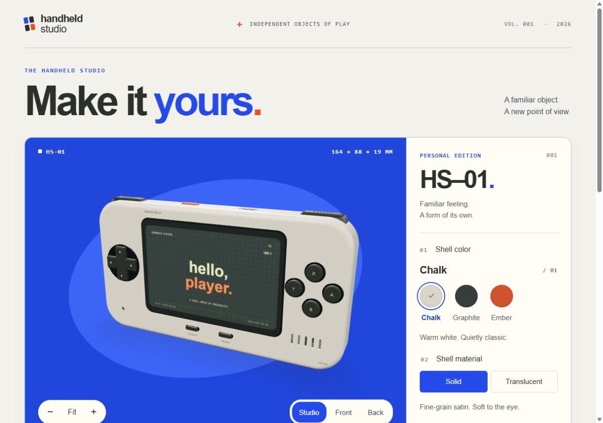
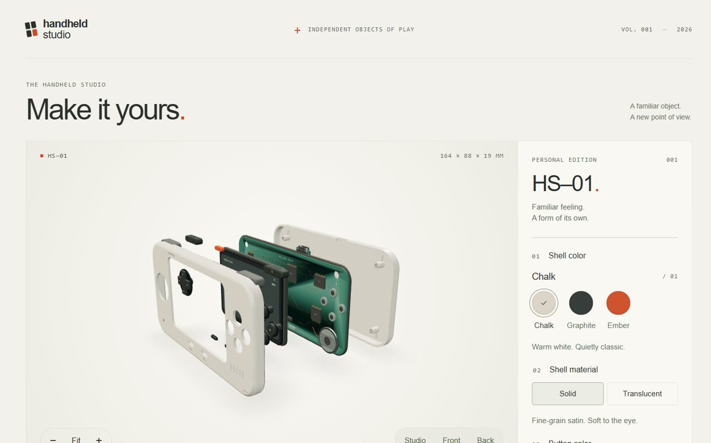
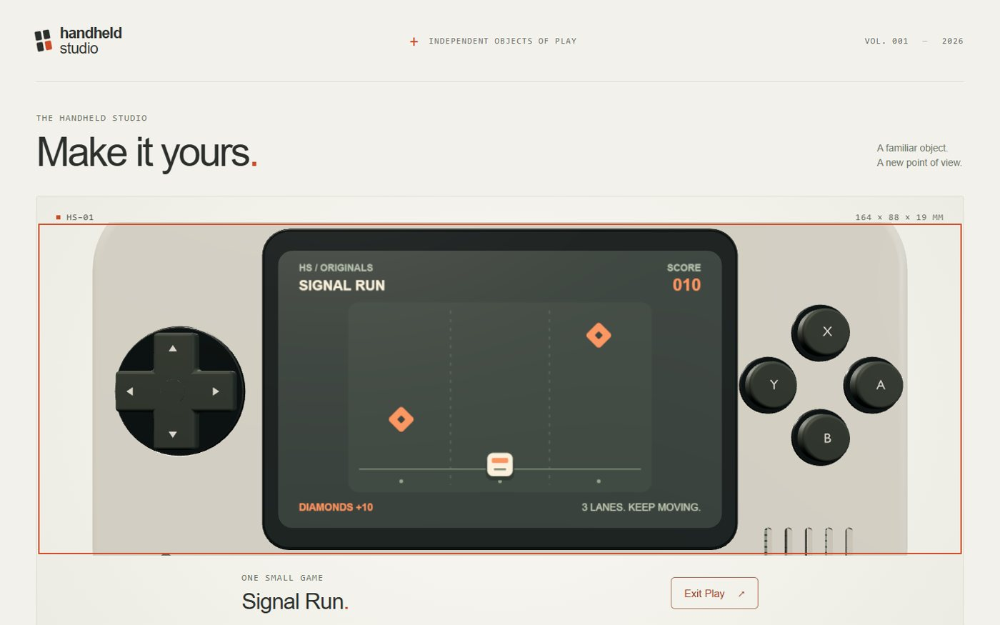
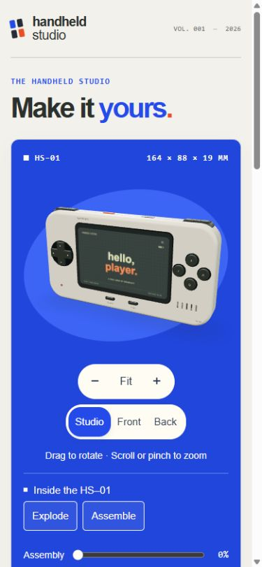

# Handheld Studio

A 3D game console you can customize, take apart and actually play. I modeled the HS-01 in Blender and built the studio around it with React Three Fiber.

**[Live site](https://handheld-studio.vercel.app)**



## What you can do

- **Make it yours.** Three shell colors, three button colors and solid or translucent plastic, 18 builds in all.
- **Inspect it.** Drag to rotate, pinch or scroll to zoom, or jump to the Studio, Front and Back cameras.
- **Take it apart.** A slider explodes the console into five layers: front shell, controls, display, board and rear shell.
- **Play Signal Run.** A small collect-and-dodge game I wrote that renders onto the console's own screen. It keeps your best score and works with the keyboard or touch.
- **Save and share.** Save a build in the browser, share it as a link, or export a 1600 × 1200 product image.

| Exploded view | Signal Run | Phone |
| --- | --- | --- |
|  |  |  |

## How it's built

- **React 19, TypeScript, Vite, React Three Fiber and Drei**, with a Blender model exported as one GLB.
- **Fewer draw calls.** Compatible meshes are batched inside each of the five layers, which cut the assembled console from 92 draw calls to 26 while every layer still moves on its own.
- **Renders only when needed.** The scene sits still until you interact, so an idle page doesn't burn battery.
- **The game is separate from React.** Signal Run runs on a fixed-step loop in its own store and draws to a canvas texture. React only re-renders the score and controls.
- **Validated configs.** A small reducer checks every build, whether it comes from local storage or a shared URL, before it reaches the scene.
- **Handles real conditions.** Reduced motion, keyboard controls, 200% text, loading and retry states, a no-WebGL fallback and recovery from lost GPU context.

## Run it

Needs Node 22.

```sh
npm ci
npm run dev       # http://127.0.0.1:5173
npm test          # 182 Vitest unit tests
npm run lint
npm run test:e2e  # Playwright browser suite (uses installed Chrome)
npm run build
```

Blender is only needed to edit the model. `npm run asset:export` re-exports `public/models/hs-01.glb` from `assets/source/hs-01.blend`.

## Credits

The HS-01 design, model, interface and game are original. These projects informed how I approached the asset pipeline and scene structure, without copying their code or assets:

- [Bruno Simon, Folio 2025](https://github.com/brunosimon/folio-2025)
- [Wang Ruofeng, Orbital Core Showcase](https://github.com/wangruofeng/orbital-core-showcase)

Third-party notices ship in [public/third-party-notices.txt](public/third-party-notices.txt).
